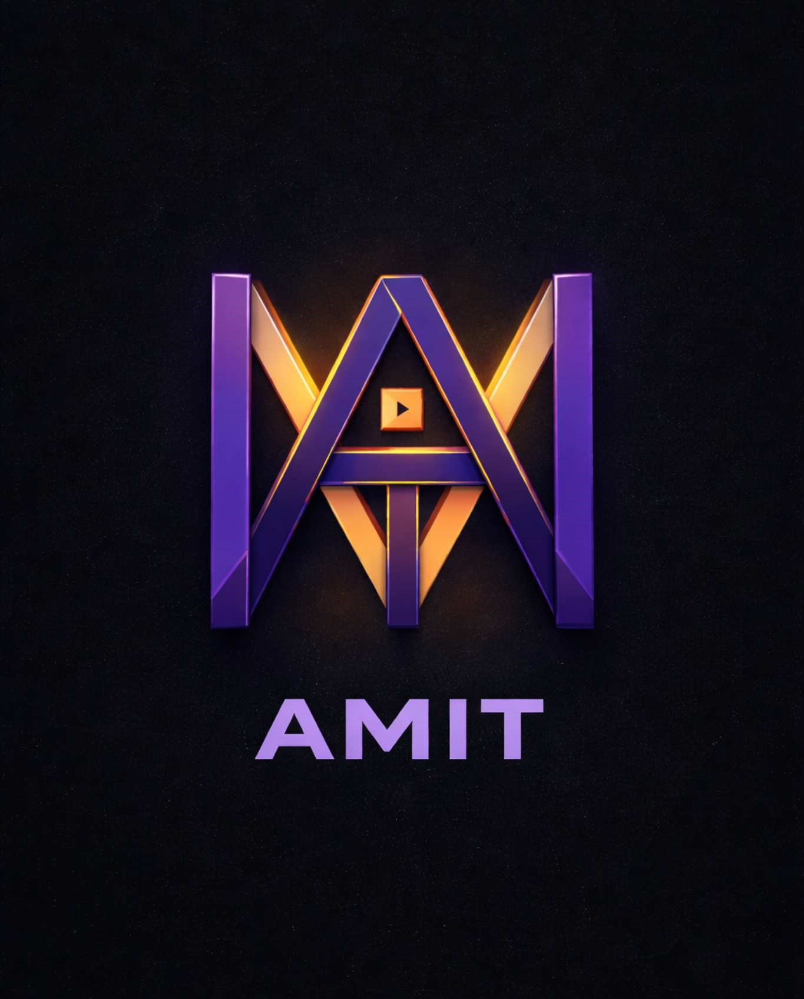
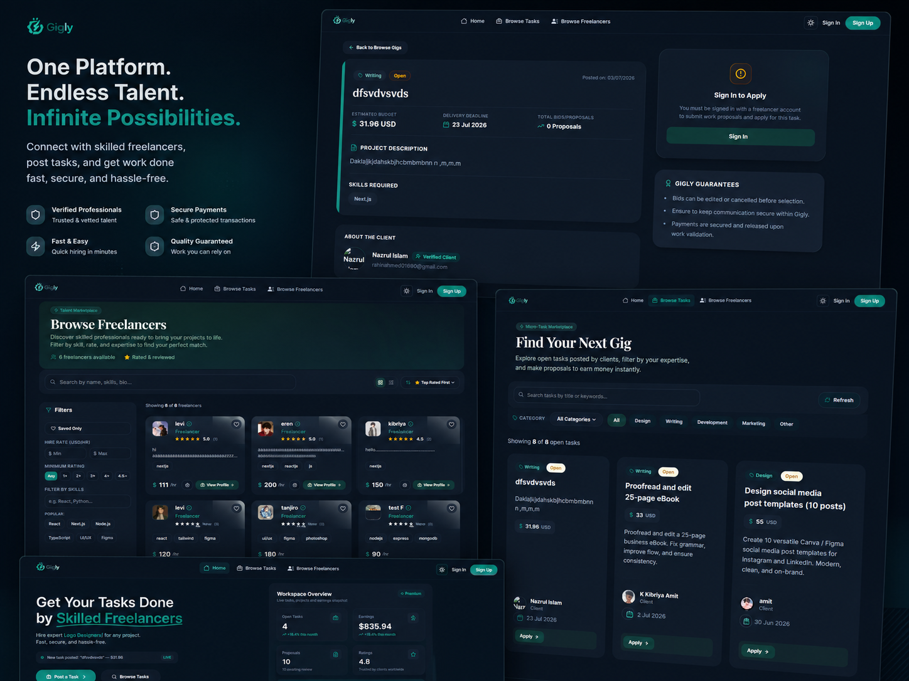
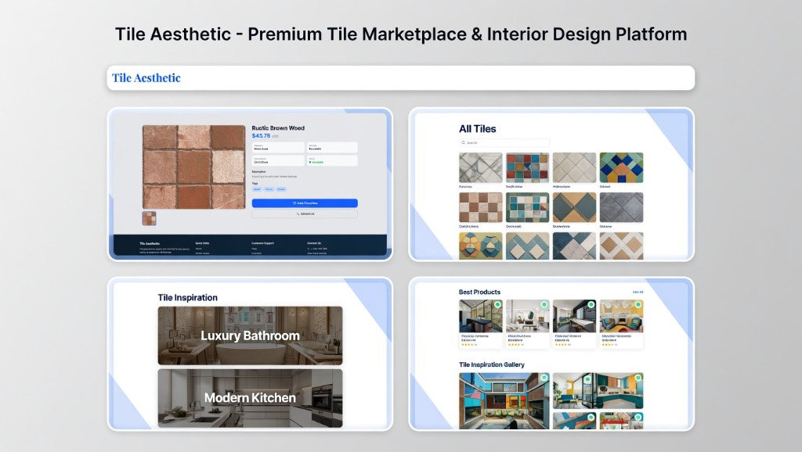

 <!-- Kibriya Amit | GitHub Profile README -->

# Hi, I'm Kibriya Amit 👋

### Junior Full-Stack Web Developer | Next.js & MERN Stack Enthusiast

*Turning ideas into modern, functional and meaningful web experiences.*

 

  

---

## 👨‍💻 About Me

- 💻 I'm a junior web developer passionate about building modern web applications.
- 🌱 Currently improving my skills in **React, Next.js, TypeScript, Node.js, and PostgreSQL**.
- 🔭 Exploring backend development, REST APIs, authentication, and database management.
- 🤖 Interested in AI integration and workflow automation.
- 🧠 I enjoy solving problems and learning new technologies through practical projects.
- 🤝 Open to collaborating on projects and connecting with fellow developers.
- 🎯 Looking for junior-level opportunities where I can learn, contribute, and grow.

---

## ⚡ Tech Stack & Tools

### Languages

### Frontend Development

### Backend & Databases

### Development Tools

---

## 🚀 Featured Projects

<table>
<tr>
<td width="50%" valign="top">

### 💜 Gigly

A freelance marketplace platform designed to connect clients with freelancers for micro-task services.

**Project Links**

</td>
<td width="50%" valign="top">

### 🟠 TutorFlux

An online tutoring platform that connects students with tutors based on their learning needs.

**Project Links**

</td>
</tr>

<tr>
<td width="50%" valign="top">

### 🟣 Tile Aesthetic

A tile marketplace website focused on showcasing tile products with a clean browsing experience.

**Project Links**

</td>
<td width="50%" valign="top" align="center">

### ✨ More Coming Soon

 

 

Always experimenting, building, and exploring new ideas.

</td>
</tr>
</table>

---

## 📚 Currently Learning

| Technology | Learning Focus |
|:---|:---|
| TypeScript | Type-safe and maintainable code |
| Next.js | Advanced concepts and full-stack development |
| PostgreSQL | SQL queries and relational databases |
| Backend Development | REST APIs and authentication |
| AI Integration | AI-powered web applications |
| Automation | Workflow automation and AI tools |

---

## 🏆 GitHub Achievements

---

## 📊 GitHub Statistics

  

---

## 🐍 Contribution Snake

---

## 📈 Contribution Activity

---

## 🤝 Let's Connect!

I'm always happy to connect with fellow developers, exchange ideas, collaborate on projects, and learn from others.

  

### ⭐ Thanks for visiting my profile!

*Keep learning. Keep building. Keep growing.*

